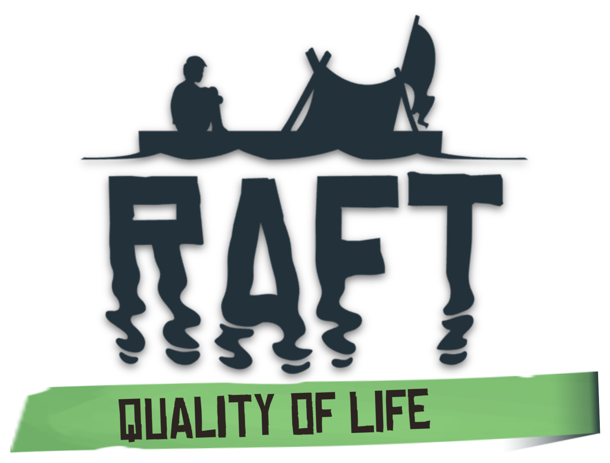

<p align="center"></p>

# Raft QoL

A fan-made quality-of-life mod for [Raft](https://store.steampowered.com/app/648800/Raft/). It makes everyday survival less tedious and leaves the game's balance and feel alone. Every feature can be switched on or off.

> **Status: 0.1.1 beta.** Tested in single-player and when hosting. Playing together with other players has not been tested yet; see [Known limitations](#known-limitations).

## Requirements
- Raft 1.1 (Steam). Developed against build 22312909. A game update can break the mod until it is patched.
- One mod loader: [BepInEx 5](https://github.com/BepInEx/BepInEx/releases) (5.4.23 or later 5.x, `win_x64`), or [Raft Mod Loader](https://www.raftmodding.com/loader) (RML, 2.8). Both builds have the same features and settings.

## Installing

### With BepInEx
1. Extract BepInEx 5 (`win_x64`) into the Raft game folder, next to `Raft.exe`.
2. **Linux / Steam Deck (Proton) only:** set Raft's Steam launch options to `WINEDLLOVERRIDES="winhttp=n,b" %command%`.
3. Copy the `RaftQoL` folder from `RaftQoL-<version>.zip` into `BepInEx/plugins/`.
4. Start the game. Settings are in the **QoL** tab of Raft's Settings window (main menu or pause menu). They are stored in `BepInEx/config/raft-qol.cfg`, and edits to that file apply while the game runs.

### With Raft Mod Loader
1. Install it from [RaftModding](https://www.raftmodding.com/mods/raft-qol), or put `RaftQoL-<version>.rmod` into the `mods` folder in the Raft game folder.
2. Start Raft through the RML launcher, press **F9**, select **Raft QoL** and click **Load selected mods**. To load it every time, open its info panel and tick **Load this mod at startup**.
3. Settings are in the same **QoL** tab and are stored in `mods/ModData/raft-qol/raft-qol.cfg`. The mod can be unloaded and loaded again from RML's mod manager without restarting the game.

Use one loader at a time: RML's launcher removes BepInEx's `winhttp.dll` and `doorstop_config.ini` from the game folder.

## Presets
- **Vanilla+** (default): convenience features only. Balance stays vanilla.
- **Relaxed:** Vanilla+ plus opt-in balance changes.
- **Custom:** set automatically as soon as you change a setting the presets control.

## Features

**Vanilla+** features are on by default. **Relaxed** features change the game's balance, so they are off until you pick the Relaxed preset or switch them on yourself. "Host" means the feature works when you host the world or play alone; as a guest it does nothing (or, for hold to fill, falls back to one item per press).

| Feature | What it does | Preset | Keys | Multiplayer |
|---|---|---|---|---|
| Craft from nearby chests | Crafting counts and uses items in closed chests within 20 m, after your inventory | Vanilla+ | | Host |
| Build from nearby chests | Building, upgrading, repairing and reinforcing use items from nearby chests | Vanilla+ | | Host |
| Quick deposit | Moves your items into nearby chests that already hold the same item. Tools, equipment and the hotbar stay with you | Vanilla+ | G | Host |
| Inventory sort button | A sort button on your inventory, like the one on chests: stacks and orders the items in your inventory and backpack. The hotbar stays as it is | Vanilla+ | Click the button | Anyone |
| Bulk craft | Shift-click Craft makes 5, Ctrl-click makes as many as you can | Vanilla+ | Shift / Ctrl + click | Anyone |
| Hold to fill | Hold Interact on tanks, grills, smelters, purifiers and cooking pots to keep adding or collecting | Vanilla+ | Hold E | Host |
| Return containers | Bowls, plates and glasses come back after eating and drinking | Vanilla+ | | Anyone |
| Raft controls | All engines on/off, reverse all engines, raise/drop all anchors, open/close all sails | Vanilla+ | K, Shift+K, J, L | Anyone |
| Steering wheel recenter | A released wheel turns back to straight; lock it with a key | Vanilla+ | U | Host |
| Look-at info | Tank levels, battery charge, fuel, cooking time left and chest fill under the crosshair | Vanilla+ | | Anyone |
| Item details | Food, water, durability and cooking result in item descriptions | Vanilla+ | | Anyone |
| Compass and raft marker | Your heading, the distance and direction to the raft when you are away from it, and to the island your receiver is tuned to | Vanilla+ | | Anyone |
| Smarter inventory | Picked-up materials go to the backpack before the hotbar; the item in your hand is refilled when it runs out or breaks (from nearby chests too when you host) | Relaxed | | Anyone |
| Keep inventory on death | Keep everything, or keep the hotbar and equipment | Relaxed | | Anyone |
| Full refund | Removing built blocks gives back all materials (adjustable), foundation armor included | Relaxed | | Anyone |
| Faster hook | The hook reels in and grabs debris twice as fast (adjustable) | Relaxed | | Anyone |
| Stacking sails, stronger engines | Extra open sails add speed; engines can move more foundations | Relaxed | | Host |

Every key can be changed in the QoL tab. Keys do nothing while a menu or the chat is open.

## Known limitations
- **Multiplayer is untested.** The mod only sends the game's own network messages, so players without it should be able to join, but nobody has tried it yet. Features marked "Host" do nothing when you join someone else's world.
- **Gamepad** controls and the Chinese, Japanese, Korean and Russian fonts in the QoL tab have not been tested.
- Settings and labels are in English only.
- **RML:** after replacing the `.rmod` while Raft is running, restart the game. Unloading and loading again keeps using the version the game started with.
- Removing the mod leaves your worlds loadable in the unmodded game: the mod adds nothing to save files.

## Multiplayer
Each feature runs either for you only, or on the host for everyone, and only uses the game's own network messages, so players without the mod (including console players) can join a modded host, and you can join an unmodded host. The table above says which features need you to be the host.

## Building from source
Requires the .NET SDK (8 or later) and a local Raft install with BepInEx.

```bash
dotnet build src -p:RaftGame="/path/to/steamapps/common/Raft"
```

The build references the game's own assemblies and copies `RaftQoL.dll` into `<Raft>/BepInEx/plugins/RaftQoL/`.

The RML package is built from the same source. RML compiles a mod's `.cs` files itself when it loads it, with C# 7.3, so the source sticks to C# 7.3 and the `.rmod` contains the source files rather than a DLL. The build compiles those files against RML's own Harmony first, as a check, so RML must have been run once on the machine (or pass its `binaries` folder with `-p:RmlBinaries=...`):

```bash
dotnet build rml -c Release -p:RaftGame="/path/to/steamapps/common/Raft"
```

This writes `releases/RaftQoL-<version>.rmod`.

## License
The source code is licensed under the [GNU General Public License v3.0](LICENSE). The images in `art/` are built from Raft's own game assets, which belong to Redbeet Interactive, so they are not covered by the GPL.

## Disclaimer
This is an unofficial fan project, and it is not affiliated with or endorsed by Redbeet Interactive. Raft and its logo, fonts, textures and models belong to Redbeet Interactive. The artwork in `art/` is built from game assets for this mod's own pages and in-game use.
